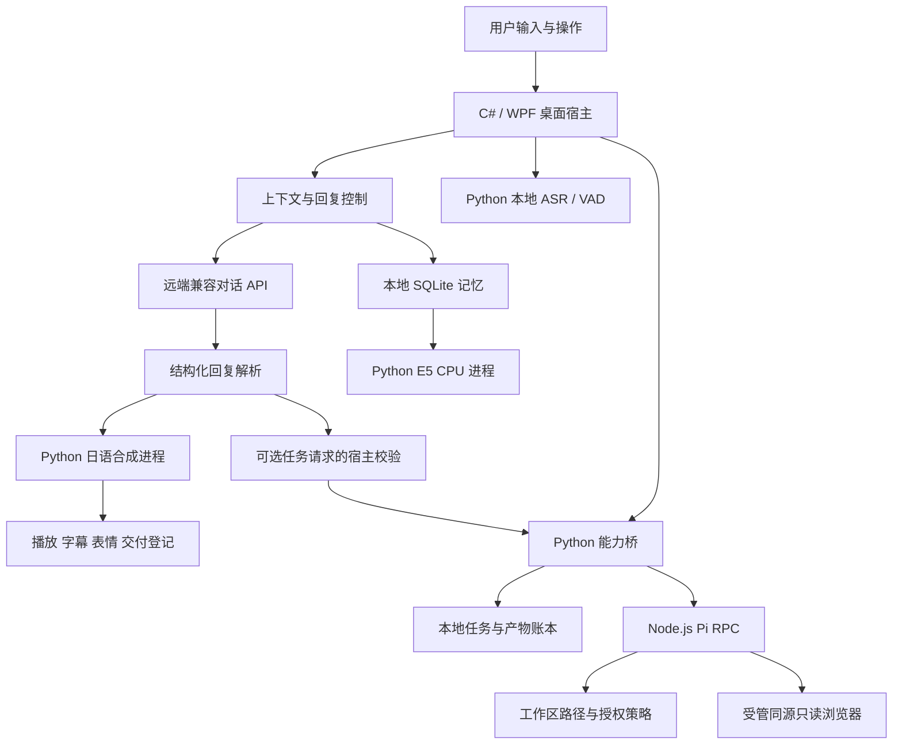

<p align="center">
  
</p>

<h1 align="center">ATRI Agent</h1>

<p align="center">基于 C#／WPF 的 Windows 桌面应用，集成中日双语对话、本地语音、可追溯记忆与受控任务执行。</p>

<p align="center">
  <a href="#10-桌面界面与生命周期"></a>
  <a href="#122-研究编译与重建"></a>
  <a href="#4-整体架构与通信机制"></a>
  <a href="./LICENSE"></a>
  <a href="#2-公开版本的组成与裁剪原则"></a>
</p>

<p align="center">
  <a href="#1-项目定位与实现范围">项目概述</a> &nbsp; / &nbsp;
  <a href="#3-目录结构与阅读路径">目录结构</a> &nbsp; / &nbsp;
  <a href="#4-整体架构与通信机制">整体架构</a> &nbsp; / &nbsp;
  <a href="#12-脚本说明与开发前提">开发前提</a> &nbsp; / &nbsp;
  <a href="#16-许可证与来源">许可与来源</a>
</p>

> [!NOTE]
> **代码快照：2026 年 10 月 23 日 · 人格与知识资料更新：2026 年 10 月 25 日**
>
> 本仓库用于技术研究、架构分析与二次开发，现提供项目实际使用的完整人格配置与角色知识 JSON。模型权重、运行环境、运行所需美术与音频、完整原作剧本、用户配置、用户数据及历史验证材料均未收录。本快照不具备完整应用的启动条件；文中“已实现”仅指源项目中的代码实现。
>
> 页首横幅用于文档展示，非应用截图。来源与权利说明见 [文档资产说明](./docs/readme/ASSETS.md)。

## 目录

| 分类 | 章节 |
| --- | --- |
| 项目与源码范围 | [项目定位](#1-项目定位与实现范围) · [公开范围](#2-公开版本的组成与裁剪原则) · [目录结构](#3-目录结构与阅读路径) |
| 系统架构与交互 | [整体架构](#4-整体架构与通信机制) · [对话与上下文](#5-对话协议与上下文管理) · [记忆与证据](#6-记忆与证据系统) · [语音合成](#7-日语语音合成与播放) · [语音与视觉输入](#8-语音输入与视觉输入) |
| 任务与桌面管理 | [工作任务与产物](#9-工作任务浏览器与产物管理) · [桌面与生命周期](#10-桌面界面与生命周期) |
| 开发与许可 | [代码索引](#11-核心代码索引) · [开发前提](#12-脚本说明与开发前提) · [理论与取舍](#13-理论基础与工程取舍) · [数据与权限](#14-数据流与权限边界) · [局限与建议](#15-局限与后续开发建议) · [许可证与来源](#16-许可证与来源) |

## 1. 项目定位与实现范围

项目集成角色对话、双语字幕、本地语音、可追溯记忆与独立工作任务。C#／WPF 宿主管理界面、身份、会话及资源，通过标准输入／输出与 Python、Node.js 子进程通信。

系统分别记录模型输出、宿主执行结果与实际交付内容。工具权限由宿主管理；未完成播放的内容不登记为完整交付，历史摘要不替代用户原始证据。

| 领域   | 源项目中可定位的实现                                        | 本源码快照提供的内容                             |
| ---- | ------------------------------------------------- | -------------------------------------- |
| 文本对话 | OpenAI 兼容对话接口、结构化回复、会话上下文、取消及错误处理                 | C# 完整宿主逻辑、通用化系统规则及外置人格与知识 JSON          |
| 角色呈现 | 表情立绘、口型切换、日语语音、中文／日文字幕                            | 布局、映射、状态与播放代码；无运行所需美术与音频              |
| 本地记忆 | SQLite 持久化、全文／语义检索、事实修订、会话摘要、原文回溯                 | 存储、检索与后台整理代码；无数据库与模型                   |
| 语音合成 | GPT-SoVITS v2ProPlus 推理编排、候选校验、失败报告               | 自有引擎、工作进程与完整性判定代码；无权重、参考音频及 vendor 推理库 |
| 语音识别 | 麦克风采样、SenseVoiceSmall／Silero VAD、本地唤醒匹配、远端 ASR 适配 | 工作进程、采样及识别控制代码；无识别模型                   |
| 图片输入 | 单张本地文件图片预处理与单次附件                                  | 图像处理、附件协议及确认界面代码                       |
| 工作任务 | 普通聊天调度与角色汇报、Work Ledger、Pi RPC、权限与产物登记、Diff 展示    | 聊天编排、桥接代码及必要的上游模块；面板入口保留               |
| 网页读取 | 受管 Chromium 的同源只读访问、正文／链接／截图提取                    | 浏览器包装与策略源码；无 Chromium                  |
| 原作场景 | 本地 PSB 场景索引与逐句文本浏览入口                              | 解析、索引和界面逻辑；无完整剧本或场景资源                  |
| 桌面模式 | 窗口／全屏切换、桌面附着与恢复                                   | Windows 窗口管理源码                         |
| 数据维护 | 记忆导入导出、清理、备份恢复与恢复出厂事务                             | 相应实现代码；无维护记录或备份                        |

接口名称仅描述兼容协议。远端推理服务及凭据需由开发者自行配置；本仓库不提供服务账户。

## 2. 公开版本的组成与裁剪原则

本版本按显式源码白名单提取，保留 C# 工程、当前桌面使用的 Python／JavaScript 逻辑、任务运行时组件源码及构建元数据。源工程的 README、运行报告及分发清单未收录；本文件、[聊天 WORK 说明](docs/chat-work.md)与第三方来源说明针对公开源码独立编写。

2026 年 10 月 25 日新增两份外置资料：[完整人格配置](assets/derived/persona.json)与[角色知识](assets/derived/knowledge.json)。两份 JSON 从原项目按字节复制，保留原字段、来源标记、知识条目与短句示例；它们描述项目采用的游戏早期共同日常时期，不是全剧情或全部角色知识的数据库。此次新增不包含完整游戏剧本、图像、音频、模型或用户交互记录。

### 2.1 已排除的内容

| 内容 | 处理方式与原因 |
| --- | --- |
| 应用运行所需的原作图像、UI、背景、立绘、字体和截图 | 不收录运行资源；`docs/readme/` 仅含文档横幅及来源说明 |
| BGM、音效、系统语音、参考音频及合成结果 | 不收录音频与缓存 |
| 完整原作剧本、整包对话语料及人格构建脚本 | 不收录剧本包或构建脚本；仅保留上述两份人格与知识 JSON 中已有的设定整理、来源与短句示例 |
| GPT／SoVITS、HuBERT、ERes2Net、E5、SenseVoice、Silero VAD、Whisper 等权重与配套文件 | 全部不收录；模型与配套文件适用各自许可 |
| Python、.NET、Node.js、Chromium、site-packages、node_modules | 不收录可执行程序与第三方运行环境 |
| data 内容、配置、DPAPI 凭据、工作区、聊天、记忆、日志、备份 | 不收录任何实际运行状态 |
| app、bin、obj、pdb、缓存、压缩包、既有发布版 | 不收录编译或历史分发产物 |
| 独立测试工程、测试数据、性能测量、验收报告与截图 | 不收录；保留宿主内嵌诊断及隔离的聊天 WORK 后端合同检查源码，不引用历史通过结论 |
| 未接入当前桌面的其他界面、壁纸、VTS 与开放扩展系统 | 不收录；任务运行时仅保留当前宿主实际使用的组件 |
| 资源解包／转换参考程序及本机专用维护脚本 | 不收录与本源码阅读目标无关的工具 |

`assets/derived/` 提供 `persona.json` 与 `knowledge.json`；其余模型、程序输出、用户数据、测试和训练目录仅保留占位文件。依赖声明和锁定清单属于工程元数据，不属于用户配置。

`docs/readme/` 仅包含 README 横幅及来源说明，不参与应用运行。文档资产维持 2026 年 10 月 22 日版本；代码快照日期为 2026 年 10 月 23 日，新增人格与知识资料及相应说明更新于 2026 年 10 月 25 日。

### 2.2 公开副本中的源码调整

`src/Atri.Core/ContextBuilder.cs` 的 `Rules` 常量保持独立、通用的虚构角色交互规则，其中不内嵌原作人物专属表演指令和逐字台词示例。结构化回复、证据边界、双语输出及可选 `work` 请求合同仍保留。角色性格、时期、称呼与说话规则由随包的 `assets/derived/persona.json` 提供，知识检索使用同目录的 `knowledge.json`；配置继续在运行时读取，不嵌入 C# 常量。源项目原文件未作修改。

另新增轻量的 `agent-runtime/vn_player/__init__.py` 命名空间标记，用于导入当前子集提供的脚本索引，不加载独立聊天运行时。

其余列入白名单的原源码按字节复制。源代码中的项目名称、类型名称和资源路径引用仍用于说明实现；这些标识不等同于随仓库提供对应资源或商标授权。

## 3. 目录结构与阅读路径

```text
.
├─ src/
│  ├─ Atri.Core/                  会话、协议、记忆、进程、路径、维护
│  └─ Atri.Desktop/               WPF 界面、音频、采样、截图和窗口控制
├─ runtime/
│  ├─ asr/                       本地识别工作进程与依赖锁定文本
│  ├─ memory/                    E5 嵌入工作进程
│  ├─ voice/                     自有合成引擎和覆盖判定；无 vendor/权重
│  └─ capabilities/
│     ├─ bridge.py               能力请求、任务状态与产物边界
│     ├─ pi_provider.py          Pi 子进程配置、事件与权限交互
│     ├─ vn_scene.py             本地场景回放状态
│     └─ node/                   Pi 入口、文件策略、网页读取与包锁
├─ agent-runtime/                任务账本、传输、产物与场景索引组件
│  ├─ agent_host/                任务账本、类型合同、Pi 传输
│  ├─ server/                    产物登记、Git/Diff 和 AUIP 校验
│  ├─ vn_player/                 纯文本规范化与剧本索引
│  └─ LICENSE
├─ scripts/                      部分构建、部署、清单和只读格式解析代码
├─ docs/chat-work.md             普通聊天任务调度与权限说明
├─ docs/readme/                  README 横幅及来源说明
├─ licenses/                     保留的依赖许可文本
├─ assets/derived/
│  ├─ persona.json               完整人格配置、时期与说话规则
│  └─ knowledge.json             角色知识、来源与短句示例
├─ models/ app/ data/ tests/ training/   空占位目录
├─ Directory.Build.props         C# 编译公共属性
├─ NuGet.Config                  工程包缓存配置
├─ Start-ATRI.cmd                原项目启动入口源码
├─ LICENSE                       原项目保留的 AGPL-3.0 完整文本
├─ THIRD_PARTY_NOTICES.md         源码快照的组件来源与许可说明
└─ README.md
```

建议按以下路径阅读：`App.cs → MainWindow.cs → ContextBuilder.cs → ProtocolClient.cs → ReplyDelivery.cs` 对应对话流程；`ChatWorkView.cs → ChatWorkSession.cs → CapabilityBridge.cs → bridge.py` 对应聊天任务生命周期；`MemoryStore.cs` 及相关文件对应证据存储与召回；`pi_provider.py → pi-entry.mjs` 对应执行权限。

`agent-runtime` 为桌面宿主提供任务与索引组件，通过能力桥接调用；其使用方式见下文的任务执行与通信流程。

## 4. 整体架构与通信机制



宿主管理会话标识、持久状态、取消令牌和执行授权。子进程分别处理语音／嵌入计算及工具任务。JSONL 按行分帧，每行包含一个 JSON 对象；结果、事件及错误状态分别报告。

Python 模型依赖与 C# 宿主进程隔离，工作任务与普通对话分别维护持久状态。聊天任务的承接、执行、收尾与汇报由同一轮次持有，运行期间暂停新的聊天输入。进程边界不构成操作系统级沙箱；访问限制依赖路径校验、工具白名单、子进程配置及宿主授权逻辑。

## 5. 对话协议与上下文管理

### 5.1 一轮对话的处理过程

1. 界面取得当前文本与可选单张图片附件，创建本轮取消范围。
2. 构造系统规则、有效人格记录、检索数据、近期对话、当前用户消息及宿主提供的任务能力快照；此时尚不保存当前消息。
3. `ProtocolClient` 向兼容接口发送请求，同一次回复给出双语内容及可选 `work` 请求，不另作一次分类推理。
4. 没有任务请求时，按普通聊天处理明确事实与历史；`segments` 中日语用于语音，中文用于字幕，`emotion` 用于表情。
5. 普通聊天结束后，`ReplyDelivery` 只登记实际完成的段落；事实候选仍须经宿主按用户原文校验。
6. 有任务请求时，宿主先校验范围并交付承接台词，再执行任务、显示进度及汇报真实结果。原始工单和工具详情不进入普通聊天记忆，只保存任务简述与真实状态。

### 5.2 回复对象

以下协议示例独立编写，未引用原作台词。

```json
{
  "segments": [
    {"ja": "確認しました。", "zh": "已确认。", "emotion": "neutral"}
  ],
  "memories": [],
  "work": null
}
```

提示规则建议每次 1–12 段，解析器的程序容量上限为 32 段。提示层建议与程序验证上限是不同约束。合法情绪为 `neutral`、`happy`、`shy`、`angry`、`proud`、`sad`、`serious`、`comfort`、`curious`、`surprised`。

日语文本是语音内容的依据；中文字幕应保持相同主体、事实、时态、否定及条件关系。程序检查结构及部分可朗读性，不提供双语语义等价的形式化保证。

`work` 可省略或为 `null`。有真实委托且宿主快照允许时，该字段才可提出 `create`、`continue`、`retry`、`report` 或 `cancel`；它不参与语音朗读，也不能授予自身权限。结果汇报轮强制禁止新的任务请求。字段和完整流程见 [聊天 WORK 说明](docs/chat-work.md)。

### 5.3 上下文预算

`ContextBuilder` 对人格、知识、事实、摘要、模型整理笔记和历史原文分别设置字符预算。近期对话最多考察 18 条，按总字符预算纳入，并对单条消息截断。历史搜索另有预算，避免将同一条已完整呈现的消息重复注入。

预算主要按字符数计算，未采用精确的模型分词计数。更换模型时需依据上下文窗口及供应方限制调整配置。

### 5.4 模型配置

配置类型提供 API 地址、模型名、温度、超时、输出 token 上限和结构化输出开关。默认温度为 `0.8`，超时为 `90` 秒，回复 token 上限为 `1600`。这些是源码默认值；

接口地址允许 HTTPS，回环地址允许 HTTP。Pi 配置另行拒绝地址中的用户名、密码、查询参数和片段。配置字段及限制以 `Settings.Validate()` 为准。

## 6. 记忆与证据系统

### 6.1 数据分层

记忆类型包含 `UserFact`、`Preference`、`Event`、`SessionSummary`、`Relationship` 和 `CharacterKnowledge`。原始消息保存会话、角色、正文和时间。长期记忆另外保存来源、证据、置信度、重要度、更新时间以及可选过期时间。

存储层维护任务状态与修订信息。事实变更保留来源依据；历史计划不自动标记为已完成事件，助手生成内容不直接归因于用户。

聊天触发的工作任务另有记忆入口：只保存明确标注为概括的指令简述、宿主状态及产物数量。原始工单、工具过程、执行器输出和完整汇报不进入聊天消息、事实、历史索引、摘要或模型整理；独立 Work 账本仍保留任务恢复所需详情。

### 6.2 召回路径

系统结合关键词／字符特征、自建词项倒排索引和语义向量召回，再按对应路径的相关性、类型、证据和时间规则处理候选。Core 的历史检索使用普通 SQLite 表 `history_terms` 和 `history_lsh`，没有使用 FTS5 虚表，也没有引入独立向量数据库服务。

语义计算由 `embed_worker.py` 在 CPU 本地加载 `multilingual-e5-small`，使用查询／文档前缀，生成 384 维归一化向量。对隐藏状态做注意力掩码平均池化后再进行 L2 归一化，点积可作为余弦相似度。具体推理形式与该模型的[固定模型卡](https://huggingface.co/intfloat/multilingual-e5-small/blob/614241f622f53c4eeff9890bdc4f31cfecc418b3/README.md)一致。

E5 缺失或进程不可用表示语义服务异常，不表示原始记忆已删除。相关路径保留文本检索与错误状态，实际可用性取决于本地依赖。

历史向量较少时进行精确比较；规模较大时使用 8 个表、每表 12 位的随机超平面 LSH，并加入词项及近期候选。最多读取 768 个候选，再进行精确余弦评分与来源复核。近似候选生成可能遗漏相关历史，不保证全量精确召回。

### 6.3 模型历史整理

模型整理通过当前对话 API 处理历史材料；输出经来源与证据检查后写入独立笔记。整理笔记不得覆盖当前用户纠正，也不直接归入原作知识。

`ModelMemoryEnabled` 源码默认开启。完整应用启用该项后，可能向配置的远端服务发送历史对话以进行整理。本地持久化与离线处理属于不同属性，使用者需按数据处理要求配置该功能。

整理使用独立的 `MemorySummaryTokens` 预算，默认 `16384`，专用调用温度固定为 `0`；该预算与普通回复的 token 上限分别设置。

### 6.4 维护功能

完整应用提供会话浏览、原文检索、记忆检索、事实管理、摘要整理、导入导出、备份恢复和清理。公开仓库仅保留相应逻辑。导出文件、用户输入、数据库、向量缓存及备份均应继续留在被忽略的本地目录。

## 7. 日语语音合成与播放

### 7.1 两阶段推理

`engine.py` 编排 GPT-SoVITS v2ProPlus 的日语推理：文本经过规范化与日语音素前端，参考音频提供音色及语义条件，语义解码器生成离散语义序列，声学／波形解码部分输出音频。GPT-SoVITS 的能力与使用方式可参阅其[官方项目](https://github.com/RVC-Boss/GPT-SoVITS)。

本仓库提供引擎编排与校验逻辑。`vendor` 源码、参考音频、角色权重、共享预训练模型及推理依赖需独立准备；本快照无法直接执行语音合成。

### 7.2 候选与完整性控制

每个语音分段最多考察 8 个候选，采用受限的情绪参考与中性参考组合。语义结束检查分别记录实际 EOS、长度限制、迭代限制与取消；token 数达到上限不作为自然结束依据。

`completeness.py` 使用本地 CPU SenseVoice 复核合成语音的读音覆盖，进行日语读音规范化、编辑对齐及缺失／重复判断。表情声、犹豫与口吃按受限模式处理，普通词语不适用通用省略规则。

指定的失败分歧可触发独立的 WhisperTurbo 仲裁路径。该路径用于合成校验，与前台麦克风识别分离；仅在满足仲裁条件时调用。

覆盖检查提供读音覆盖证据，不验证全部音素、音色、韵律及自然度。候选用尽时报告失败，未通过结果不作为正常交付。

### 7.3 播放与字幕

WPF 播放模块维护音频段、字幕段、口型变化和取消状态。音量分别控制角色语音、界面音效和背景音乐。`GameAudio` 将背景、音效及系统提示作为独立通道管理，并在录音／说话时调整背景活动。

原作背景、系统提示与音效依赖外部目录及校验清单。本快照保留管理代码，未提供音频或原作语音转录。

## 8. 语音输入与视觉输入

### 8.1 本地语音输入

`Microphone` 通过 Windows 音频接口采集数据；`LocalAsrProcess` 管理本地工作进程；`worker.py` 使用 SenseVoiceSmall 进行识别，并由 Silero VAD 处理语音活动和分句边界。源码另有本地唤醒词匹配与自动发送选项。

VAD 估计当前窗口的语音活动；唤醒匹配基于识别文本，不提供说话人身份认证。录音默认行为、唤醒模式与自动发送由不同配置项控制。

本地模型通过 sherpa-onnx 加载；其支持方式见 [SenseVoice 官方部署说明](https://k2-fsa.github.io/sherpa/onnx/sense-voice/index.html)。远端识别模式由 `ProtocolClient` 对接音频转写接口，需要使用者自行提供对应服务。

### 8.2 图片输入

视觉附件模块支持通过文件选择器选择一张 PNG、JPEG 或 BMP。图片在本地解码、限制尺寸并重新编码，移除原图附带元数据；请求发送图片内容，不包含原始本地文件路径。

图片经预览确认后加入当前对话。当前附件入口不支持剪贴板图片或桌面截图；WORK 网页截图属于独立产物，宿主内嵌布局截图用于诊断。服务端需支持所选模型的图片输入。

## 9. 工作任务、浏览器与产物管理

### 9.1 独立的 Work 生命周期

普通聊天与工作任务分别建模，并由聊天宿主连接。用户可在普通对话中要求新建、执行、继续、重试、查询或停止任务，原 WORK 面板功能保留。`bridge.py` 接收主机命令，在受控工作区创建或读取任务，登记每次运行尝试、事件、权限请求及产物。主机重启后将仍处于执行中的尝试标记为执行者丢失，不自动重新执行历史任务。

宿主校验可选请求后，先通过正常双语台词与日语语音承接，随后在后台调度；输入框显示“亚托莉正在工作”，暂停发送、录音及图片输入。进度区域显示实际状态，结束、失败或取消后再以普通对话汇报。汇报接口失败时保留双语兜底，语音异常时保留完整文字。无法处理或现有任务指代不明确时应先说明或澄清。

`ChatWorkSession` 持有稳定请求标识和精确的执行尝试；回执丢失时查询原任务，避免重复创建。中止及会话切换、记忆维护和退出需要等待执行停止确认。停止无法确认时暂停新的聊天，不把口头承诺或执行器自述当作真实完成。详见 [聊天 WORK 说明](docs/chat-work.md)。

`WorkLedgerStore` 负责 SQLite 持久化；`WorkArtifactRegistry` 在尝试边界记录基线，并登记可归因的文件变化；`collect_diff` 与 `parse_unified_diff` 提供 Git 变化及统一差异的结构化表示。模型生成说明与宿主观测产物分别记录，具有不同证据来源。

### 9.2 Pi 的实际权限

`pi_provider.py` 以隔离配置启动固定版本的 Pi 原生 RPC。`pi-entry.mjs` 是 JavaScript ESM 入口，不是 TypeScript 编译产物。当前依赖声明固定 Pi `0.86.1`、Playwright Core `1.62.1`、`pi-simple-web-tools` `0.1.0` 和 TypeBox `1.3.27`。

面板任务默认工具仅有 `read`、`ls`；允许写入的尝试才会加入 `write`、`edit`，且每次写操作仍需经界面确认。聊天中明确委托的任务可自动获得其受管工作区内的文件读写权限，写入仍登记权限账本，路径与凭据文件检查不放宽。Shell 和未知工具被策略拒绝。凭据由主机通过启动消息传入内存配置，不读取旧 `.env`、扩展目录、技能目录或 Pi 用户会话。

聊天新任务使用专用工作区；继续、重试保留已有任务身份和登记工作区。文字成果的口吻来自随包的外置人格文件，代码、结构化数据、引用和精确格式要求优先；人格不扩大执行能力。其他未随包提供的运行资源仍需使用者合法准备，角色与引用内容的权利范围见 [第三方来源说明](THIRD_PARTY_NOTICES.md)。

文件策略拒绝工作区外路径、链接／联接、Git 内部及常见凭据文件。单次文件读取预算为 2 MiB，参数序列化预算为 256 KiB。该策略仅约束应用工具访问，不提供针对任意本机恶意程序的隔离保证。

### 9.3 可选的 Codex CLI 提供方

代码保留已安装 Codex CLI 的发现、登录状态检查与工作任务适配。该提供方使用外部 CLI 的既有认证，启动参数包括临时会话、忽略用户配置、JSON 事件及固定的 `workspace-write` 沙箱。

该提供方在 Work 任务启动时经用户批准后获得工作区写入权限，未接入 Pi 的逐工具写入确认；界面的 Pi 写权限选项不改变其固定 CLI 参数。模型、工具及沙箱行为由实际安装的 CLI 决定，Pi 的禁用 shell、默认只读及逐次确认策略不适用于该提供方。公开仓库不包含 CLI、登录信息或运行数据。

### 9.4 受管浏览器

`browser.mjs` 仅允许与用户批准的 origin 完全一致的 HTTP(S) URL，检查协议、主机及端口，拒绝地址内凭据。请求限于 GET／HEAD，阻止 WebSocket、服务工作线程及下载接收，不读取用户浏览器配置。

结果包括页面标题、截断正文、链接摘要及视口截图。该模块不提供通用点击、表单提交、登录、跨域研究或任意浏览器控制；访问限制通过 Playwright 的[网络路由能力](https://playwright.dev/docs/network)实现。

### 9.5 场景与 AUIP

保留的 `vn_player/script_index.py` 和 `text.py` 负责文本规范化、剧本索引与行匹配；`scripts/psb.py` 读取未加密的 PSB 结构。场景界面逐句显示文本及来源，不重建原游戏音画；仓库没有供该场景入口浏览的完整剧本或场景资源。人格与知识 JSON 中保留的少量来源短句不构成完整场景包。

AUIP 模块在当前桥中用于清单及消息合同验证。当前桌面未集成上游完整的交互式应用、控制接管及外部插件功能。

## 10. 桌面界面与生命周期

完整应用具有标题页、对话页与 SYSTEM 控制台。控制台包含 MODEL、SOUND、MEMORY、SYSTEM、WORK；WORK 下提供任务与产物、场景以及网页工具相关界面。

| 页面／入口 | 完整应用中的操作流程 | 对应实现 |
| --- | --- | --- |
| MODEL | 配置对话接口／模型／密钥及参数；配置 ASR 来源、设备、VAD 和唤醒 | `ConsoleView.cs`、`Settings.cs` |
| SOUND | 选择 TTS 模型、字幕语言、角色语音开关及各通道音量 | `ConsoleView.cs`、`VoiceProcess.cs` |
| MEMORY | 检索会话、管理事实与摘要、执行导入导出／整理 | `ConsoleView.cs`、`Memory*.cs` |
| SYSTEM | 切换显示／桌面模式并检查组件；恢复出厂入口位于 MEMORY | `ConsoleView.cs`、`DesktopHost.cs`、`FactoryResetView.cs` |
| WORK | 选择任务和工作区，批准权限，查看输出与变化 | `CapabilityView.cs` |
| 对话附图 | 选择本地图片，预览确认后随当前消息发送 | `VisualInputView.cs` |

窗口以 1280×720 为设计坐标，通过布局缩放呈现。`WindowDisplayController` 管理窗口／全屏模式，`DesktopHost` 通过 Windows 窗口关系实现桌面附着；该实现不具备跨平台壁纸引擎能力。

关闭、取消、切换记忆库和恢复出厂过程协调录音、音频、模型进程及后台任务。`generation`／取消令牌等状态用于拒绝过期回调，防止历史任务向新会话写入结果。

恢复出厂清除或重建指定的用户记忆与运行状态，重置用户称呼／会话，保留 API 配置、DPAPI 密钥、设备及其余运行偏好。加密凭据仍属于私人数据，不得提交至公共仓库。

## 11. 核心代码索引

| 文件／模块 | 阅读重点 |
| --- | --- |
| `src/Atri.Desktop/App.cs` | 应用入口、根目录发现与启动错误 |
| `src/Atri.Desktop/MainWindow.cs` | 页面、对话轮次、段交付、取消及退出 |
| `src/Atri.Core/ProtocolClient.cs` | 请求构造、端点、结构解析和修复 |
| `src/Atri.Core/ContextBuilder.cs` | 可信规则、检索数据、近期消息与证据候选 |
| `src/Atri.Core/ReplyDelivery.cs` | 已显示／已播出内容和中断元数据 |
| `src/Atri.Core/ChatWork.cs`、`ChatWorkSession.cs` | 可选任务协议、范围校验、身份、取消与停止确认 |
| `src/Atri.Core/ChatWorkMemory.cs`、`src/Atri.Desktop/ChatWorkView.cs` | 任务简记、聊天输入锁、进度、语音承接及结果汇报 |
| `src/Atri.Core/MemoryStore.cs` | 记忆存储入口与维护状态 |
| `src/Atri.Core/MemorySearch.cs`、`MemoryRetrieval.cs` | 不同召回路径与候选评分 |
| `src/Atri.Core/MemoryHistory.cs` | 历史消息搜索与原文片段 |
| `src/Atri.Core/MemoryDigestGenerator.cs`、`MemoryModelMaintenance.cs` | 模型整理、检查与后台推进 |
| `src/Atri.Core/MemoryObservation.cs`、`MemoryConsolidation.cs` | 显式事实和长期摘要维护 |
| `src/Atri.Core/Settings.cs` | 配置验证、原子写入和 DPAPI 凭据封装 |
| `src/Atri.Core/AppPaths.cs` | 受控路径、链接拒绝、缓存与日志 |
| `src/Atri.Core/FactoryReset.cs` | 旧文件暂存、校验、事务提交／回滚及崩溃恢复 |
| `src/Atri.Core/VoiceProcess.cs` | 语音进程身份、请求与生命周期 |
| `runtime/voice/engine.py`、`completeness.py` | 合成候选、终止和覆盖判定 |
| `runtime/asr/worker.py` | 识别、VAD、输入帧及会话 |
| `runtime/memory/embed_worker.py` | 固定本地 E5 推理协议 |
| `runtime/capabilities/bridge.py` | 主机侧任务和产物授权 |
| `runtime/capabilities/pi_provider.py` | Pi 事件、确认、取消与恢复边界 |
| `runtime/capabilities/node/` | 内存配置、工具策略与同源浏览器 |
| `agent-runtime/agent_host/work_ledger_store.py` | 上游任务账本的事务存储 |
| `agent-runtime/server/work_artifact_registry.py` | 基线和变化归因 |

索引按文件名称组织，不依赖随版本变化的行号。

## 12. 脚本说明与开发前提

### 12.1 保留脚本的职责

| 脚本 | 功能 | 在本快照中的前提／限制 |
| --- | --- | --- |
| `Environment.ps1` | 将临时目录及依赖缓存指向项目 data 下 | 执行会创建本地目录并设置当前进程环境 |
| `Build.ps1` | 发布 WPF 工程，可选择调用源项目测试程序 | `-Tests` 所需测试工程未提供；构建结果不含完整运行依赖 |
| `Start-ATRI.ps1`、`Start-ATRI.cmd` | 发现应用、必要时构建并检查人格入口 | 已含人格与知识 JSON，仍缺少运行美术、音频、模型和依赖；本快照不支持完整启动 |
| `Check-Environment.ps1` | 检查完整产品的资源及组件路径 | 本快照缺少相关资源，检查可能报告缺失项 |
| `setup-asr.ps1` | 部署锁定 ASR 依赖、模型与校验文件 | 需要本地 Python；执行会联网下载，权重不随仓库提供 |
| `setup-memory.ps1` | 下载固定修订的 E5 并生成部署哈希 | 需要已准备的本地推理 Python；执行会联网 |
| `setup-capabilities.ps1` | 检查桥接依赖，可安装锁定 Node 包及浏览器 | `-Verify` 依赖未随本快照提供的验证程序；安装会联网 |
| `prepare-voice.py` | 从独立上游目录提取推理所需代码并映射模型 | 上游目录、权重及相关授权均未提供 |
| `bundle-voice.py` | 根据实际导入证据组装隔离推理环境 | 原有验证记录和上游运行包未提供 |
| `freeze-runtime.py` | 构建完整运行版清单和 SBOM | 需要完整资源；不适用于生成本源码快照 |
| `make-release.py`、`Release.ps1` | 从完整产品清单生成并校验运行版 | 依赖有意排除的资源、文档清单及验证组件 |
| `runtime/capabilities/verify_chat_work.py` | 使用真实账本与合成 Pi 通信的隔离合同检查 | 不调用外部模型；已含所需外置人格，源产品的其他资源和验证前提仍需补齐 |
| `psb.py` | 未加密 PSB v2/v3 的只读结构解析 | 仅解析器，无剧本或资源数据 |

保留脚本用于说明原工程的构建与分发流程。`Release.ps1` 面向完整运行版，可能收集运行所需模型及资源，不适用于公开源码筛选。

### 12.2 研究编译与重建

`Atri.Core` 目标框架为 `net9.0`；`Atri.Desktop` 为 `net9.0-windows` 并启用 WPF。C# 研究编译需要相应 Windows .NET SDK 及桌面引用程序集。编译仅生成程序集，Python／Node 依赖、模型及运行素材需另行准备。

二次开发需在独立副本中，按使用范围核对随包人格、知识及其他资源的来源与适用条款，并配置模型服务及本地依赖。使用自有角色或替换资源时，应重新定义资源清单与人格资料；恢复出厂代码包含源产品的资源完整性假设，替换资源后需重新审查相关校验合同。

本仓库不提供可执行程序、账户、安装器、完整测试集合或用于绕过缺失依赖的占位配置。

## 13. 理论基础与工程取舍

### 13.1 RAG 与分层记忆

检索增强生成从持久资料中选择相关片段，作为当前模型输入，以控制上下文规模并提供可追溯证据；该流程不保证检索内容正确。项目分别保留原始消息、显式事实、摘要、角色知识及模型笔记，不以单一摘要替代全部证据。

### 13.2 向量表示与相似度

掩码平均池化可写为 `h = Σ(mask_i × token_i) / Σ(mask_i)`，归一化为 `z = h / ||h||₂`。归一化向量的点积等于余弦相似度。召回还需结合文本候选、证据及时间信息；相似度不等同于事实置信概率。

### 13.3 结构化输出与合同校验

JSON 结构约定分别表达内容、情绪、字幕及记忆候选。解析器检查字段、类型及部分约束；语言含义、记忆真实性及行为完成状态由证据层处理。格式修复仅用于结构恢复，不重新生成历史问题的回答。

### 13.4 语音活动与识别

音频采样将连续声压转换为离散采样序列；VAD 估计窗口中的语音活动；ASR 将语音段转换为文本。唤醒策略由上层状态机实现。静音分句、文本匹配与说话人认证属于不同能力。Silero VAD 的模型背景见[官方仓库](https://github.com/snakers4/silero-vad)。

### 13.5 序列对齐与覆盖判断

TTS 校验对预期日语读音与识别读音进行规范化及编辑对齐。插入、删除与替换可提示重复或缺失；考虑到 ASR 误差，判定还需受限例外、结束证据及仲裁条件。识别文本相近不构成声学质量保证。

### 13.6 并发与生命周期

界面线程管理控件与可视状态，后台任务处理网络、计算及进程读取。取消令牌、请求标识和代际状态共同限制过期结果写回。语音段、录音会话、工作尝试及记忆维护分别管理生命周期。

### 13.7 持久化与恢复

SQLite 事务用于保持相关修改的一致性；普通表索引、词项倒排表和 LSH 表服务于检索。预写日志与检查点的背景可参阅 SQLite 的 [WAL 文档](https://www.sqlite.org/wal.html)；具体初始化语句应分别查阅记忆存储和 Work 存储。

恢复出厂通过受控清单、旧文件事务暂存、校验及恢复入口协调多个文件，属于应用级恢复协议，不提供跨文件系统的统一事务保证。提交成功后清理旧文件暂存；在线备份与备份恢复另由 `MemoryStore` 提供。

### 13.8 凭据与最小权限

DPAPI 将凭据加密与 Windows 用户／系统环境关联，降低明文配置直接泄露的风险；加密文件仍需保密，同一账户下的程序可能具备解密条件。基础接口见微软的 [CryptProtectData 文档](https://learn.microsoft.com/en-us/windows/win32/api/dpapi/nf-dpapi-cryptprotectdata)。

工具权限由宿主和工具入口共同约束。路径检查、工具白名单与逐次确认是不同边界：批准一个任务目标不意味着开放所有文件和任意命令。

## 14. 数据流与权限边界

| 数据／动作 | 所在边界 | 实现含义 |
| --- | --- | --- |
| 对话输入与上下文 | 发往用户自行配置的远端模型服务 | 可能含当前消息、召回事实、历史与图片 |
| 模型历史整理 | 当前对话 API | 开启时可能发送已结束会话材料 |
| 本地 ASR、E5、TTS 校验 | 本地工作进程 | 依赖本地文件；与远端对话路径分开 |
| 远端 ASR | 自行配置的识别服务 | 录音数据将离开设备 |
| 工具读取结果 | Pi 模型上下文 | 读取的文件或网页内容可能进入已配置模型的请求 |
| 网页 URL 与资源请求 | 用户批准的网站 origin | 同源只读访问仍会发出网络请求 |
| API 密钥 | DPAPI 文件及子进程内存 | 原始文件和内存配置均不随仓库提供 |
| Pi 文件写入 | 被批准的项目内工作区 | 面板写入逐次确认；聊天明确委托的任务自动批准受限工作区文件写入并登记账本 |
| 聊天工作记忆 | 普通记忆与 Work 账本分别保存 | 聊天仅保留概括和状态；恢复所需工单与执行详情留在独立 Work 账本 |
| Codex 任务写入 | 任务启动时批准的工作区 | 固定 workspace-write；不经过 Pi 的逐工具确认 |

日志接口注释要求仅记录应用诊断，不传入用户正文、供应方响应或凭据。该要求属于调用约束，新增日志需逐处检查。

## 15. 局限与后续开发建议

本快照的功能说明基于源码静态核对。公开源码整理与检查不执行角色应用、远端模型或录音；源码可编译不等于本快照具备完整启动条件，也不把源项目的局部验证视为公开副本的端到端验收。

当前实现面向 Windows 桌面。完整启动依赖固定资源路径及资源合同，相关资源未随公开版提供。Pi 入口直接引用锁定版本的 SDK bundle 文件，升级时需同步核实入口及 RPC 合同。

真实外部模型对聊天任务的路由、工具调用支持、人格表现和多日连续运行仍须独立评价。当前没有新增完整 MCP／Skills、任意联网搜索或桌面操作；普通对话中的任务入口不扩大原有执行器的能力。

后续开发可优先抽离角色数据合同、将资源清单改为可替换接口、建立不含原作语料的合成测试集合，并以独立角色验证交付一致性、记忆证据及权限拒绝行为。补充运行依赖时，应继续分别管理模型、源码、素材及用户数据。

## 16. 许可证与来源

根 `LICENSE` 及 `agent-runtime/LICENSE` 保留 GNU AGPL v3 完整文本。第三方组件及适配代码保留原有归属与许可；初期参考和组件来源集中说明于 [THIRD_PARTY_NOTICES.md](THIRD_PARTY_NOTICES.md)。

GPT-SoVITS、Pi 与其他依赖拥有各自许可。保留代码调用并不意味着附带模型、角色、声线、商标或第三方素材的使用授权。项目名称用于标识该研究工程，不表示与原作权利人或上游项目存在官方合作关系。

文档横幅中的角色与美术适用独立权利，根代码许可证不授予其额外使用权，详见 [文档资产说明](./docs/readme/ASSETS.md)。

新增人格与知识 JSON 保留项目编写的交互规则、原作角色资料的整理、来源及少量引用。原作角色、剧情设定及引用台词的权利仍归相应权利人所有，不因根代码的 AGPL-3.0 许可获得额外授权；具体范围见 [第三方来源说明](THIRD_PARTY_NOTICES.md)。

发布范围限于本目录，包括上述两份外置人格与知识资料。模型、运行所需美术与音频、完整原作剧本、用户状态、历史说明、外层本地项目详解及整理核验记录不属于公开内容。
